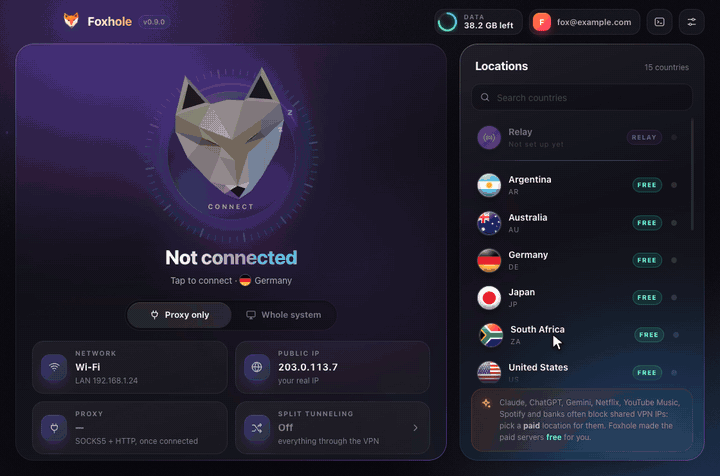
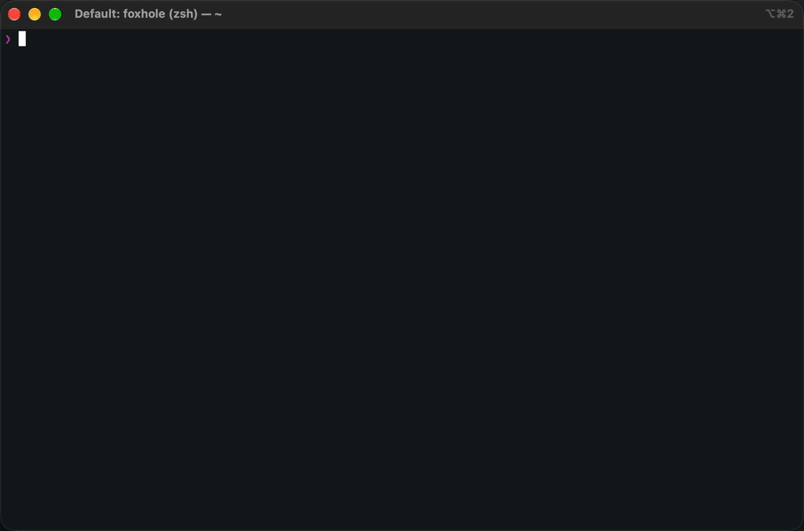

# foxhole-vpn 🦊 — Firefox's free VPN for your whole system

[](https://www.npmjs.com/package/foxhole-vpn)
[](https://www.npmjs.com/package/foxhole-vpn)
[](LICENSE)


Use **Firefox's built-in VPN** (the free "IP Protection" proxy) outside the
browser: a **local SOCKS5 + HTTP proxy** for any app, or **whole-system VPN
routing**, on Linux, macOS and Windows. A desktop app or a terminal app.



> Unofficial. Not affiliated with Mozilla. Routing all your system traffic
> through Firefox's VPN is probably outside Mozilla's intended use; your account
> and its monthly data cap are your responsibility.

## Features

- 🌍 **Free VPN servers**: US, Germany, Japan, Australia, Argentina, South Africa
- 🧦 **SOCKS5 and HTTP proxy on one port** (`127.0.0.1:1080`) for any app
- 🛡️ **Whole-system mode** (TUN) with DNS over HTTPS inside the tunnel and IPv6/QUIC leak protection
- 📞 **Calls** through it: UDP to the ports the VPN takes (WebRTC's), in whole-system mode
- ✂️ **Split tunneling**: pick the sites and apps that skip the VPN, or the only ones that use it (apps: on computers, and on Android in whole-system mode; iOS can only split sites)
- 🇮🇷 **Iranian sites direct** in one switch, and **Save data**: other sites go direct too where they open, blocked ones through the VPN
- 🔎 **Blocked or sanctioned?** Split tunneling's **Check** tries a site directly and through the VPN: Iran's filter, sanctions, or open (then it can skip the VPN). And when Iran cuts the international internet off, Foxhole says so
- 📊 **Data by site**: which sites spend the VPN's monthly data, when it runs out at this rate, and one click to send a big one direct; hide the sites you'd rather not list
- ✈️ **Telegram in one tap**: the proxy card's button sets Telegram on this device; with sharing on, a QR code sets your phone's
- 📱 **Share with your phone** on the same Wi-Fi
- 📺 **Smart DNS for a TV or console**: set its DNS to your computer, and YouTube and blocked or sanctioned sites open on it, with no app
- 📲 **Share Foxhole** with the family, no internet needed: your relay and split tunneling by QR code or link, and from an Android phone the app itself to a phone nearby
- 🧮 **Look like a calculator** (Android): for a phone that may be searched, Foxhole's icon and name become a calculator's that works as one, and your code, then =, opens Foxhole. Android's own Settings still list Foxhole, and while it's connected Android shows its VPN
- 🔘 **Quick Settings tile and a widget** on Android: on or off without opening the app, and the month's data left on the home screen
- 🗣️ **In Persian too** (فارسی), right to left: the desktop and phone apps, with the tray, the notification, the tile and the widget, by Settings → Language. **In Russian too** (Русский), by the same setting. The terminal UI and the CLI stay in English
- 🟣 **Relay mode** for networks that block Firefox VPN (e.g. Iran)

## Install

**Desktop app** (no Node.js needed): download from the
[latest release](https://github.com/Diercohen/foxhole-vpn/releases/latest).

- **Mac:** `Foxhole-<version>-arm64.dmg` (Apple chip) or `-x64.dmg` (Intel), macOS 13+.
  First start: **System Settings → Privacy & Security → Open Anyway**.
- **Windows:** the `.exe`. SmartScreen: **More info → Run anyway**.
- **Linux:** the `.deb` (preferred) or `.AppImage`.

It updates itself and lives in the tray / menu bar. It opens disconnected; connecting goes on to whole-system mode unless you last picked **Proxy only**. **Settings → Start when you log in** starts it there, connected to your last location (in whole-system mode only if that needs no password or prompt).

**Terminal app** (Node.js 18.18+):



```sh
npm install -g foxhole-vpn && foxhole
```

Ubuntu 24.04: `sudo apt install nodejs npm && sudo npm install -g foxhole-vpn`.
Ubuntu 22.04's Node is too old: `sudo snap install node --classic` first.

**Before you start:** sign in to the **Firefox browser** with a Mozilla account
(Sync can stay off). foxhole reads that login to get the VPN token; if you're
signed out, it opens Firefox's sign-in for you. Or sign in in Foxhole itself, in **Accounts** (the desktop app's
window, or `a` in the terminal UI → **Sign in to a Mozilla account**, with your email, password and the code Mozilla emails).
On a first start the terminal asks which: `e` your email, or `f` Firefox's sign-in (whose screen offers `e` too).

## Usage

```sh
foxhole                     # interactive TUI
foxhole proxy --country US  # just the proxy
sudo env "PATH=$PATH" foxhole global --country US   # route the whole system
foxhole countries           # list countries
foxhole usage               # data left this month
foxhole doctor              # check login, server list, entitlement
foxhole restore             # undo whole-system routing if foxhole was killed
```

In the TUI: pick a country and press **Enter** to connect (it starts disconnected).
**`g`** ticks or unticks **Global TUN**: ticked, the default, connecting goes on to
whole-system mode (asks for your password in-app), and your choice is kept for next
time. **`t`** split tunneling (**`i`** Iranian sites direct, **`s`** save data, **`?`** checks a site as you type it), **`m`** data by site (**`h`** hides a site from it, **`a`** shows the hidden), **`a`** accounts, **`l`** logs, **`s`** settings
(**Use in Telegram** shows its QR code, **Share settings** yours).
On Windows, whole-system mode asks for administrator rights in Windows' own
prompt, once: allow **Windows PowerShell**. With it Foxhole sets up its network helper,
a scheduled task running a PowerShell script in `C:\Program Files\Foxhole Helper`, and
Windows doesn't ask again. It only runs the commands whole-system mode needs, and only
you may start it. To remove it, in an administrator PowerShell:
`Get-ScheduledTask foxhole-net-* | Unregister-ScheduledTask -Confirm:$false; Remove-Item -Recurse "$env:ProgramFiles\Foxhole Helper"`.

On Linux and macOS the password is asked **once**: with it Foxhole sets up a small
network helper, as other VPN apps do, and whole-system mode needs no password after
that. The helper is a root-owned script (`net`, in `/usr/local/libexec/foxhole` on Linux,
`/Library/PrivilegedHelperTools/foxhole` on macOS) and one sudoers rule
(`/etc/sudoers.d/foxhole-<uid>`) for your user, no background service. It only runs the
exact commands whole-system mode needs, so a program of yours could use it to send this
computer's traffic through a proxy on this computer, but not to get a root shell. To remove
it, run `sudo <that folder>/net uninstall`.

Point an app at the proxy:

```sh
export ALL_PROXY=socks5://127.0.0.1:1080
export HTTPS_PROXY=http://127.0.0.1:1080 HTTP_PROXY=http://127.0.0.1:1080
```

Whole-system mode needs [tun2socks](https://github.com/xjasonlyu/tun2socks);
foxhole downloads it for you. If GitHub is blocked, put the binary on your `PATH`.

## Where Firefox VPN is blocked (e.g. Iran)

Set up a **relay**: a free Google Apps Script on your own account. Use
**Settings → VPN relay → Set up step by step** (in the app, or `s` in the TUI);
it shows each click with a screenshot. The relay:

- reaches `vpn.mozilla.org` for foxhole when it's blocked, or refuses your
  country ("VPN not available in this region"): only small control calls,
  your traffic still goes through Firefox VPN. Once connected, even those go
  through the VPN, so the relay only gets the first pass of each connect; and
- can carry your browsing itself: pick **Relay** at the top of Locations.

**On an Android phone or TV**, make the relay on a computer (Apps Script's setup needs one), then bring it over on
the same Wi-Fi: on the phone or TV, **Settings → VPN relay → Get it from your computer** shows a QR code and a
6-character code; on the computer, or a phone that has the relay, **Settings → VPN relay → Send to a TV or phone**
scans the QR code or takes the code. A TV signed in from a phone or computer (**Settings → Sign in a TV**) gets its
relay with the sign-in; in the terminal UI, **Settings → Sign in a TV** takes the TV's code and sends both (tab leaves
the relay out), and a TV or phone waiting for a relay alone gets just the relay. On a TV the relay only reaches Mozilla: a TV's apps don't trust relay mode's certificate, so it has
no **Relay** location. iPhones don't have the relay yet.

**Split tunneling → Iranian sites direct** sends Iran's sites around the VPN: by
name (`.ir`, and 57,000 more from [iran-hosted-domains](https://github.com/bootmortis/iran-hosted-domains))
and by address ([Iran's ranges](https://github.com/ipverse/country-ip-blocks)), refreshed weekly through the VPN.
Banks and payment pages work, and that traffic costs Iran's cheaper rate instead of the VPN's data.
**Save data** goes further: every other site is tried directly first, and one that's blocked
(the filter's DNS answer, a reset, silence) goes through the VPN and is remembered for 3 days.
Your provider then sees which sites you visit. Sites that refuse Iranian addresses
([sanctioned](https://github.com/Chocolate4U/Iran-v2ray-rules)) always use the VPN.
On a Mac, Save data works in Proxy only mode.

**Settings → Smart DNS for a TV or console** (desktop app and TUI) makes your computer the DNS server of
the home's other devices: a smart TV, a PlayStation or Xbox, an iPhone. On the device, set DNS by hand to the
address Foxhole shows. While Foxhole is connected, a site Iran blocks (the network's DNS answers with the filter's
address, or stops a test handshake with it) or one that refuses Iran ([sanctioned](https://github.com/Chocolate4U/Iran-v2ray-rules)) is answered
with your computer's address: the device's connection comes to Foxhole on port 443 or 80, and goes on through
the VPN to the site its TLS SNI or HTTP Host names. Every other site gets the network's own answer and goes direct.
Only the web and WhatsApp's messages go through: games' and calls' traffic doesn't. An iPhone's iCloud Private Relay and a browser's
secure DNS skip it. On an iPhone, every app except Safari needs its permission on, in **Settings → Privacy & Security → Local Network**, to reach your computer. When the computer is off, set the device's DNS back to automatic. On a Mac, the device's Telegram, which
doesn't use DNS, goes through too once the device has your computer as its router: Settings says how (and asks your
password once, for the network helper). Linux keeps ports 53, 80
and 443 for root: `sudo sysctl -w net.ipv4.ip_unprivileged_port_start=53` lets Foxhole have them (add it to
`/etc/sysctl.d/` to keep it).

**Settings → Share Foxhole** gives the family's other devices your split tunneling's sites and, if you tick it, your
relay, so nobody else has to set one up. A phone on the same Wi-Fi scans its QR code with the camera and opens them in
Foxhole; or send the link (`foxhole://settings?d=…`), and they paste it into **Settings → Import settings**, which
shows what it changes first. From an Android phone the same QR code also gives a phone without Foxhole the app itself,
over the Wi-Fi or the phone's hotspot, with no internet (Android asks to let the browser install apps). Anyone with
the code or link can use your relay. Rules for apps stay each device's own.

**Fixes without an update:** when the filtering changes, foxhole picks up the workaround (other addresses for
Mozilla's servers, more Google sites for relay mode to reach directly) and a short notice from [`hot.json`](hot.json),
which it checks against the developer's signing key. It fetches the file at start and every 6 hours from GitHub,
jsDelivr and githack, through the VPN when connected and through your relay when nothing else answers. A file that
doesn't verify, or is older than the one it has, is ignored.

Relay mode is web-only, slower, has no country choice and **doesn't hide your IP**
(Google forwards it). Sites with bot checks (Cloudflare, Reddit, ChatGPT) refuse
it. It needs foxhole's certificate trusted; foxhole asks after your first connect.
Command-line tools: `eval "$(foxhole env)"`. The script is in
[`assets/relay/Code.gs`](assets/relay/Code.gs).

## In a sandbox (Docker)

Proxy only, with nothing installed but Docker (sign in to Firefox on your computer first):

```sh
docker build -t foxhole-sandbox -f sandbox/Dockerfile https://github.com/Diercohen/foxhole-vpn.git
docker run -it --rm --init -p 127.0.0.1:1080:1080 \
  -v "<path to your Firefox profile>/signedInUser.json:/root/.mozilla/firefox/sandbox.default/signedInUser.json:ro" \
  -v foxhole-config:/root/.config/foxhole-vpn \
  foxhole-sandbox proxy --host 0.0.0.0
```

For whole-system mode on Linux, add `--network host --cap-add NET_ADMIN
--device /dev/net/tun -v /run/dbus/system_bus_socket:/run/dbus/system_bus_socket`
and drop `-p … proxy --host 0.0.0.0` (that D-Bus socket gives the container
near-root on your computer). In Iran, add
`--build-arg BASE=registry.docker.ir/library/node:22-bookworm-slim` to the build.

## Limits

- **UDP to some ports only**: the VPN carries UDP to ports 80, 443, 3478, 8080, 8443 and 49152 and up, so calls
  (WhatsApp, Discord, Teams and other WebRTC apps) work in whole-system mode; DNS, NTP and most games' ports don't.
  QUIC stays on TCP, which is faster through it.
- The VPN may refuse non-web ports (e.g. SSH `:22`); git over SSH to GitHub
  still works via `ssh.github.com:443`.
- Whole-system mode refuses to start next to another full-tunnel VPN (`--force` overrides).
- Without systemd-resolved (Linux), DNS falls back to your own resolvers, which leaks; foxhole says so.

## How it works

foxhole reads your Firefox Account login from your Firefox profile, exchanges it
for a short-lived proxy pass from Mozilla's Guardian API (see [AUTH.md](AUTH.md)),
and runs a local SOCKS5 + HTTP proxy that tunnels through Firefox VPN's Fastly
servers. Whole-system mode adds a TUN device (tun2socks) and routes everything into it.

## Building

```sh
npm install && npm run build   # the CLI: node dist/cli.js
cd gui && npm install && npm start   # the desktop app (Node 22.12+); npm run dist for installers
cd mobile && npm install && npm run build   # the Android app (Node 22.13+, JDK 17, Android SDK + NDK 27.1)
```

The Android app is the desktop app's window and core in React Native, on Node for
Android ([nodejs-mobile](https://github.com/nodejs-mobile/nodejs-mobile)), with
[hev-socks5-tunnel](https://github.com/heiher/hev-socks5-tunnel) for whole-system
mode. Its APKs, one per ABI, land in `mobile/android/app/build/outputs/apk/release`,
signed with the keystore at `FOXHOLE_KEYSTORE` (`FOXHOLE_KEYSTORE_PASSWORD`,
`FOXHOLE_KEY_ALIAS`), or else the debug key.

The Persian is `gui/renderer/fa.js` and the Russian `gui/renderer/ru.js`, by the English. A window text is written
t\`…\` (the core's messages as they are); `node gui/i18n.test.mjs --missing [ru]` lists
the ones with no translation yet, and the GUI's tests fail on them.

Release: push a tag (`git tag v1.1.0 && git push origin v1.1.0`); GitHub builds
the apps into a draft release.

## License

[MIT](LICENSE) © Dier Cohen. The Iranian sites list in `assets/lists` is
bootmortis/iran-hosted-domains' (MIT, [its license](assets/lists/LICENSE-iran-hosted-domains)); Iran's
address ranges are ipverse/country-ip-blocks' (CC0).
