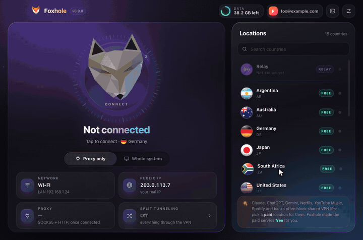
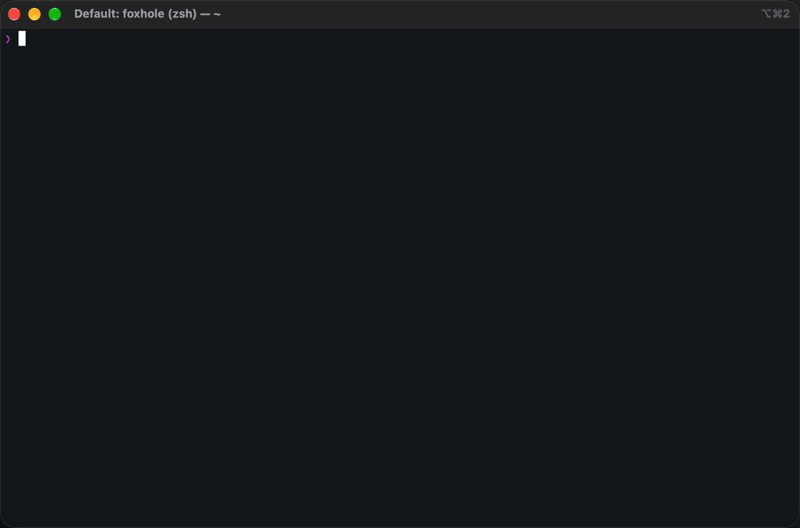

# foxhole-vpn 🦊 — Firefox's free VPN for your whole system

[](https://www.npmjs.com/package/foxhole-vpn)
[](https://www.npmjs.com/package/foxhole-vpn)
[](LICENSE)


Use **Firefox's built-in VPN** (the free "IP Protection" proxy) outside the
browser: a **local SOCKS5 + HTTP proxy** for any app, or **whole-system VPN
routing**, on Linux, macOS and Windows. A desktop app or a terminal app.



> Unofficial. Not affiliated with Mozilla. Routing all your system traffic
> through Firefox's VPN is probably outside Mozilla's intended use; your account
> and its monthly data cap are your responsibility.

## Features

- 🌍 **Free VPN servers**: US, Germany, Japan, Australia, Argentina, South Africa
- 🧦 **SOCKS5 and HTTP proxy on one port** (`127.0.0.1:1080`) for any app
- 🛡️ **Whole-system mode** (TUN) with DNS over HTTPS inside the tunnel and IPv6/QUIC leak protection
- ✂️ **Split tunneling**: pick the sites that skip the VPN, or the only ones that use it
- 📱 **Share with your phone** on the same Wi-Fi
- 🟣 **Relay mode** for networks that block Firefox VPN (e.g. Iran)

## Install

**Desktop app** (no Node.js needed): download from the
[latest release](https://github.com/Diercohen/foxhole-vpn/releases/latest).

- **Mac:** `Foxhole-<version>-arm64.dmg` (Apple chip) or `-x64.dmg` (Intel), macOS 13+.
  First start: **System Settings → Privacy & Security → Open Anyway**.
- **Windows:** the `.exe`. SmartScreen: **More info → Run anyway**.
- **Linux:** the `.deb` (preferred) or `.AppImage`.

It updates itself and lives in the tray / menu bar.

**Terminal app** (Node.js 18.18+):



```sh
npm install -g foxhole-vpn && foxhole
```

Ubuntu 24.04: `sudo apt install nodejs npm && sudo npm install -g foxhole-vpn`.
Ubuntu 22.04's Node is too old: `sudo snap install node --classic` first.

**Before you start:** sign in to the **Firefox browser** with a Mozilla account
(Sync can stay off). foxhole reads that login to get the VPN token; if you're
signed out, it opens Firefox's sign-in for you.

## Usage

```sh
foxhole                     # interactive TUI
foxhole proxy --country US  # just the proxy
sudo env "PATH=$PATH" foxhole global --country US   # route the whole system
foxhole countries           # list countries
foxhole usage               # data left this month
foxhole doctor              # check login, server list, entitlement
foxhole restore             # undo whole-system routing if foxhole was killed
```

In the TUI: pick a country, **`g`** toggles whole-system mode (asks for your
password in-app), **`t`** split tunneling, **`l`** logs, **`s`** settings.
On Windows, whole-system mode asks for administrator rights in Windows' own
prompt: allow **Windows PowerShell**.

Point an app at the proxy:

```sh
export ALL_PROXY=socks5://127.0.0.1:1080
export HTTPS_PROXY=http://127.0.0.1:1080 HTTP_PROXY=http://127.0.0.1:1080
```

Whole-system mode needs [tun2socks](https://github.com/xjasonlyu/tun2socks);
foxhole downloads it for you. If GitHub is blocked, put the binary on your `PATH`.

## Where Firefox VPN is blocked (e.g. Iran)

Set up a **relay**: a free Google Apps Script on your own account. Use
**Settings → VPN relay → Set up step by step** (in the app, or `s` in the TUI);
it shows each click with a screenshot. The relay:

- reaches `vpn.mozilla.org` for foxhole when it's blocked (only small control
  calls; your traffic still goes through Firefox VPN), and
- can carry your browsing itself: pick **Relay** at the top of Locations.

Relay mode is web-only, slower, has no country choice and **doesn't hide your IP**
(Google forwards it). Sites with bot checks (Cloudflare, Reddit, ChatGPT) refuse
it. It needs foxhole's certificate trusted; foxhole asks after your first connect.
Command-line tools: `eval "$(foxhole env)"`. The script is in
[`assets/relay/Code.gs`](assets/relay/Code.gs).

## In a sandbox (Docker)

Proxy only, with nothing installed but Docker (sign in to Firefox on your computer first):

```sh
docker build -t foxhole-sandbox -f sandbox/Dockerfile https://github.com/Diercohen/foxhole-vpn.git
docker run -it --rm --init -p 127.0.0.1:1080:1080 \
  -v "<path to your Firefox profile>/signedInUser.json:/root/.mozilla/firefox/sandbox.default/signedInUser.json:ro" \
  -v foxhole-config:/root/.config/foxhole-vpn \
  foxhole-sandbox proxy --host 0.0.0.0
```

For whole-system mode on Linux, add `--network host --cap-add NET_ADMIN
--device /dev/net/tun -v /run/dbus/system_bus_socket:/run/dbus/system_bus_socket`
and drop `-p … proxy --host 0.0.0.0` (that D-Bus socket gives the container
near-root on your computer). In Iran, add
`--build-arg BASE=registry.docker.ir/library/node:22-bookworm-slim` to the build.

## Limits

- **TCP only**: no UDP, so WebRTC, VoIP and games don't work through it.
- The VPN may refuse non-web ports (e.g. SSH `:22`); git over SSH to GitHub
  still works via `ssh.github.com:443`.
- Whole-system mode refuses to start next to another full-tunnel VPN (`--force` overrides).
- Without systemd-resolved (Linux), DNS falls back to your own resolvers, which leaks; foxhole says so.

## How it works

foxhole reads your Firefox Account login from your Firefox profile, exchanges it
for a short-lived proxy pass from Mozilla's Guardian API (see [AUTH.md](AUTH.md)),
and runs a local SOCKS5 + HTTP proxy that tunnels through Firefox VPN's Fastly
servers. Whole-system mode adds a TUN device (tun2socks) and routes everything into it.

## Building

```sh
npm install && npm run build   # the CLI: node dist/cli.js
cd gui && npm install && npm start   # the desktop app (Node 22.12+); npm run dist for installers
```

Release: push a tag (`git tag v0.9.1 && git push origin v0.9.1`); GitHub builds
the apps into a draft release.

## License

[MIT](LICENSE) © Dier Cohen
